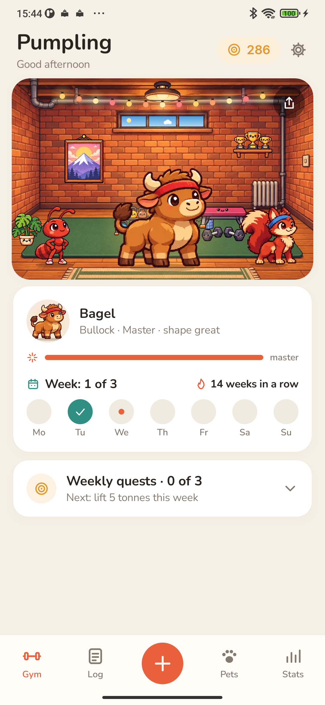
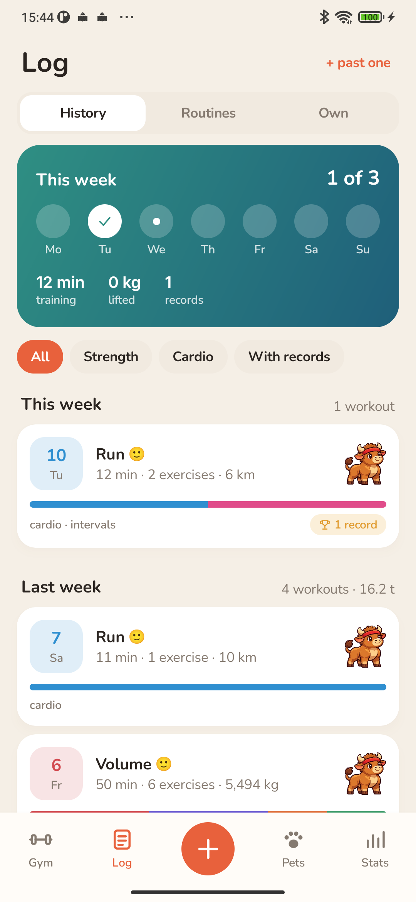
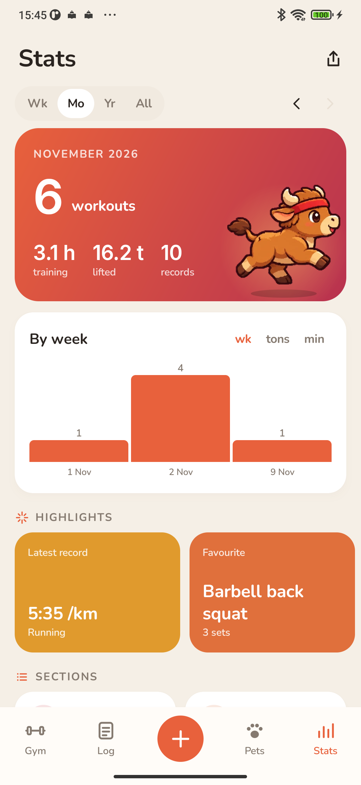

<p align="center"></p>

<h1 align="center">Pumpling</h1>

<p align="center">A workout log with pets that train alongside you.<br>
<a href="https://bigdevwhale.github.io/stillcraft/apps/pumpling/">Website</a> · <a href="https://github.com/bigdevwhale/pumpling/releases/latest/download/Pumpling.apk">Download APK</a> · <a href="README.ru.md">Русский</a></p>

Log your sets, weights and cardio, and your team in a small basement gym does the same: the leader presses a tiny barbell, the two beside it cheer. Every set feeds them, and they grow on rest days – like real muscles. The longer you train, the more pets you find: eggs turn up from the way you train.

<p align="center">



</p>

## What's inside

- **Workouts.** Sets for any exercise: weight and reps, bodyweight, assisted, holds, cardio with distance, or just minutes. Last time's sets and a nudge to beat them; a star tells you a set will be a record. A rest timer in the notification and a plate calculator.
- **140 exercises and your own.** Search and filter by family and equipment. Add your own exercise in a minute and pick its muscles on a body map; add your own equipment too.
- **33 ready routines** for the gym, home and outdoors, from beginner to advanced: full body, splits, single muscle groups, running, stretching. Look inside before you take one. Build your own in a few taps or save any workout as a routine.
- **Twenty pets** with abilities: the bullock loves legs, the otter cardio, the octopus pulls, the owl evening workouts, the phoenix a comeback. Three on the team, and their abilities add up. A grown pet takes a build from what it was raised on.
- **A gym with a window** that shows the time of day and the weather in your town. Plates from workouts, records and weekly quests furnish it.
- **Stats.** Workouts, tonnage, time and records by week, month, year or all time; a muscle map, push/pull balance and sets per muscle; each exercise's progress; best 5 and 10 km times; strength standards and DOTS; weight and measurements with before-and-after photos; a year in review as stories.
- **Cards to share:** fourteen kinds – a workout, a record, the week, month and year, a pet, the gym, the bestiary, an exercise's progress, muscles and more – in feed and story sizes, with six backgrounds and weights hidden if you like.
- **No punishment.** The week counts, not every day. Sick leave keeps your streaks.

## Install

Download [Pumpling.apk](https://github.com/bigdevwhale/pumpling/releases/latest/download/Pumpling.apk) on a phone with Android 9 or later, open it and allow installs from that source when Android asks.

## Privacy

No ads, no account, no analytics. Workouts and pets stay on your phone; only your town's coordinates go out, for the weather in the gym window. See [PRIVACY.md](PRIVACY.md).

## Build

JDK 17+ (Android Studio's JBR works) and the Android SDK.

```
git clone https://github.com/bigdevwhale/pumpling.git
cd pumpling
./gradlew assembleDebug
./gradlew assembleDebug -Pdemo        # app.pumpling.demo: half a year of training
```

Kotlin, Jetpack Compose, Room, DataStore. The exercise catalogue is `app/src/main/assets/exercises.tsv`; ready routines are in `Templates.kt`. The pet, gym and item art was made with AI image generation (`tools/gen_art.py`, `tools/cut.py`).

## License

MIT. Fonts Nunito, Inter and Press Start 2P (SIL OFL). Weather by [Open-Meteo](https://open-meteo.com) and [MET Norway](https://api.met.no). The muscle map outlines come from [react-native-body-highlighter](https://github.com/HichamELBSI/react-native-body-highlighter) (MIT, © 2022 ELABBASSI Hicham).

Pumpling is one of the [StillCraft](https://bigdevwhale.github.io/stillcraft/) apps.
