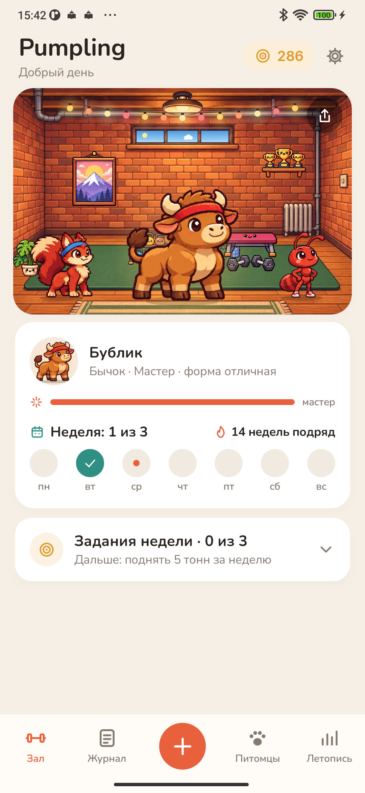
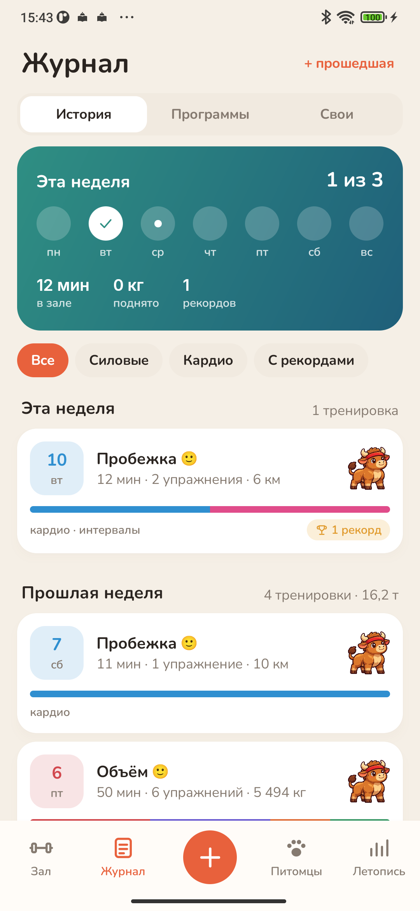
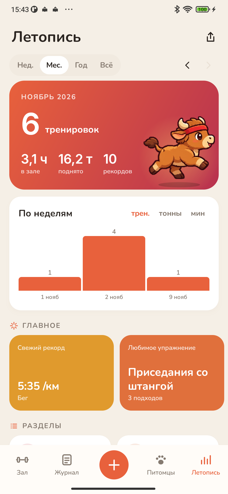

<p align="center"></p>

<h1 align="center">Pumpling</h1>

<p align="center">Дневник тренировок с питомцами, которые тренируются вместе с вами.<br>
<a href="https://bigdevwhale.github.io/stillcraft/apps/pumpling/">Сайт</a> · <a href="https://github.com/bigdevwhale/pumpling/releases/latest/download/Pumpling.apk">Скачать APK</a> · <a href="README.md">English</a></p>

Записывайте подходы, веса и кардио, а ваша команда в маленьком подвальном зале делает то же самое: ведущий жмёт штангу, двое рядом болеют. За каждый подход питомцы получают еду, а растут в дни отдыха – как настоящие мышцы. Чем дольше вы занимаетесь, тем больше находите питомцев: яйца появляются в зависимости от того, как именно вы тренируетесь.

<p align="center">



</p>

## Что внутри

- **Тренировка.** Подходы для любого упражнения: вес и повторы, свой вес, гравитрон, удержание, кардио с километрами или просто минуты. Видно, что было в прошлый раз, и подсказка, как прибавить. Звёздочка заранее показывает, что подход станет рекордом. Таймер отдыха виден и в уведомлении, есть калькулятор блинов для штанги.
- **140 упражнений и свои.** Поиск и фильтры по виду и инвентарю. Своё упражнение добавляется за минуту, мышцы выбираются на фигуре. Можно добавить и свой инвентарь: тренажёр Смита, TRX, санки.
- **33 готовые программы** для зала, дома и улицы, от новичка до опытного: всё тело, сплиты, отдельные группы мышц, бег, растяжка. Перед тем как взять программу, видно, что в неё входит. Свою программу можно собрать за пару нажатий, а любую тренировку – сохранить как программу.
- **Двадцать питомцев.** У каждого своя способность: бычок любит ноги, выдра – кардио, осьминог – тяги, сова – вечерние тренировки, феникс – возвращение после перерыва. В команде трое, и их способности складываются. Взрослый питомец получает телосложение по тому, на чём его растили: силач, марафонец, атлет, гимнаст или универсал.
- **Зал с окном.** За окном время суток и погода вашего города. За тренировки, рекорды и задания недели дают блины – на них зал обставляется вещами.
- **Летопись.** Тренировки, тоннаж, время и рекорды за неделю, месяц, год или за всё время. Карта мышц и баланс жимов и тяг, подходы в неделю на каждую мышцу, прогресс каждого упражнения, лучшее время на 5 и 10 км, нормативы силы и очки DOTS, вес и замеры с фото «до и после». В конце года – итоги в виде сторис.
- **Открытки.** Четырнадцать видов: тренировка, рекорд, неделя, месяц, год, питомец, зал, бестиарий, прогресс упражнения, мышцы и другие. Для ленты и для сторис, шесть фонов на выбор, веса можно скрыть.
- **Без наказаний.** Важна неделя, а не каждый день. Если заболели, включите больничный, и серии не сгорят.

## Установка

Скачайте [Pumpling.apk](https://github.com/bigdevwhale/pumpling/releases/latest/download/Pumpling.apk) на телефон с Android 9 или новее, откройте файл и разрешите установку из этого источника, когда Android спросит.

## Приватность

Без рекламы, аккаунта и аналитики. Тренировки и питомцы хранятся только на телефоне. В сеть уходят лишь координаты города, чтобы показать погоду за окном зала. Подробнее – в [PRIVACY.md](PRIVACY.md).

## Сборка

JDK 17+ (подойдёт JBR из Android Studio) и Android SDK.

```
git clone https://github.com/bigdevwhale/pumpling.git
cd pumpling
./gradlew assembleDebug
./gradlew assembleDebug -Pdemo        # app.pumpling.demo: полгода тренировок
```

Kotlin, Jetpack Compose, Room, DataStore. Каталог упражнений лежит в `app/src/main/assets/exercises.tsv`, готовые программы – в `Templates.kt`. Питомцы, зал и вещи нарисованы нейросетью (`tools/gen_art.py`, `tools/cut.py`).

## Лицензия

MIT. Шрифты Nunito, Inter и Press Start 2P (SIL OFL). Погода – [Open-Meteo](https://open-meteo.com) и [MET Norway](https://api.met.no).

Pumpling – одно из приложений [StillCraft](https://bigdevwhale.github.io/stillcraft/).
